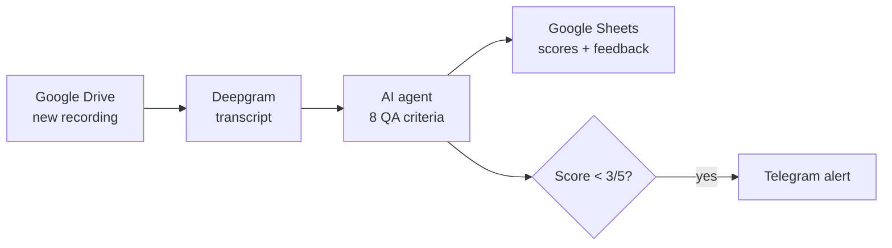

# AI Call Quality Assurance & Automated Reporting

> Every call transcribed and scored by AI on 8 QA criteria, results in Google Sheets, Telegram alert for poor calls.

 

## Problem

- Call quality was checked manually and only on a small sample.
- Bad calls were noticed too late.

## Solution

Built in **n8n**:

1. Picks up new recordings from Google Drive
2. Transcribes them with Deepgram (speaker diarization)
3. AI agent scores the agent on 8 criteria from 1 to 5: greeting, active listening, needs discovery, empathy, expertise, clear solution, next steps, customer satisfaction
4. Overall rating Good / Fair / Poor with positive and negative feedback
5. Saves results, transcript and recording link to Google Sheets
6. Telegram alert when a call scores below 3/5

## Architecture

## Tech stack

- n8n
- Deepgram
- Google Gemini
- Google Drive, Sheets
- Telegram Bot API

## Results

- Consistent automated QA for every call instead of manual spot checks
- Managers get alerted about bad calls right away

## Workflow files

The production workflow JSON is not published publicly. I'm happy to walk you through it on a call or adapt it to your stack.

## Case study & demo

Full case study with screenshots and a demo video: **[Notion portfolio](https://tree-plantain-8cf.notion.site)**

## Author

**Kyrylo Kirillov** — AI Automation Engineer (n8n, Make, LLM agents)  
[Upwork](https://www.upwork.com/freelancers/~019bcb1ca9cd59b3ad) · [LinkedIn](https://www.linkedin.com/in/kirillov-kirill) · [Portfolio](https://tree-plantain-8cf.notion.site) · Telegram [@Veter218](https://t.me/Veter218)
